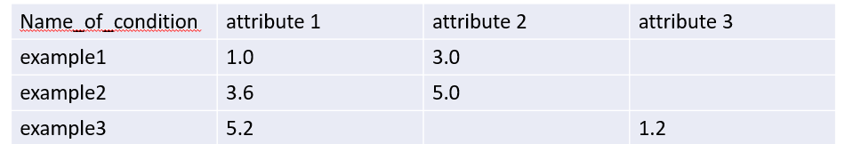
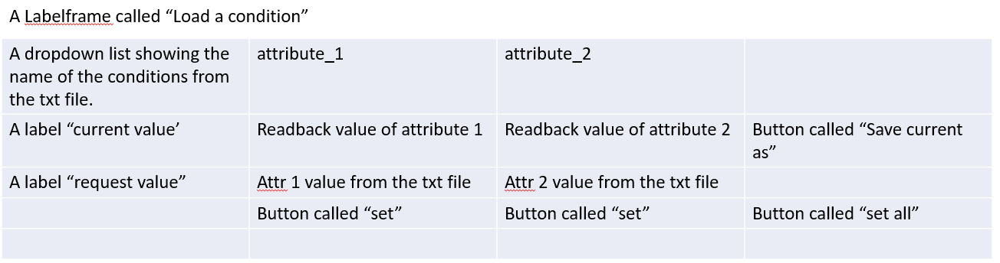
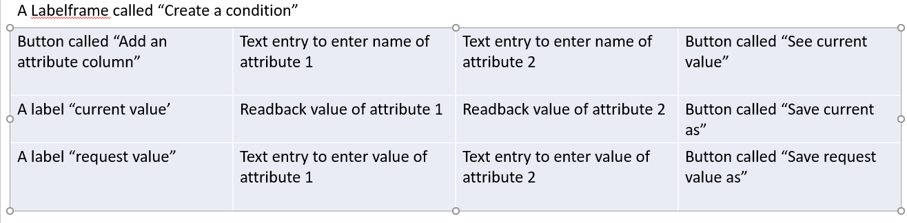

# This is a client side GUI. It uses Tkinter. Write the code to condition_setter.py

# It has two main functionalities. First, it sets the values for a list of parameters (Tango attribute) instead of just one, using the value from a txt file. Second, it can save a list of attribute name and value from user input to the same txt file.

# A txt file ("Z:\software\Condition_setter\condition_list.txt") records all the attributes and their values. The column names are "name_of_condition", attribute_1, attribute_2...See the attached picture. Sometimes a condition doesn't use all the attributes, then just leave them blank.

# When I run the condition_setter.py, a small window pops up. There are only two buttons: "Load conditions" and "Save conditions". When either is clicked, a window pops up.

# When Load conditions is click, the pop up window looks like this

At the start up, since no condition is selected, many of the grids are empty. attribute names, readback values, request values are all empty. When a condition is selected from the dropdown list, the mentioned cells should be filled with data and the number of columns (attributes) is determined and size of pop up window might change.
The "save current as" button is to save the current value of the attributes to the txt file. Once it is a clicked, a dialog pop up asking for name of the condition. "Please enter the name of this condition"."save" and "cancel" buttons are in the bottom of the dialog.
Button "set" is to set the value for one attribute. In this way, the users can manually determine which condition to set first. And "set all" is to set the values for all the attributes.

# When Save conditions is click, the pop up window looks like this

The users have to enter the full name of the tango attribute. By default, leave 3 columns for 3 attributes.
Button "see current value" is to show the current value of the entered attributes.
Button "save current as" is same as the one in load conditions window.
Text entry is to enter value of attribute. This is for the users to enter a request value for the attributes.
Button “Save request value as” is to save the entered attribute and value to the txt file.

# The readback value from both windows should be refreshed every 1 s. The readback value should be highlighted with green color. When the readback value is 0, highlight it with red. This is to alert that this value might comes from a motor power back.

# add a shortcut to shortcut\Windows

AI questions:
A few points need clarification:

Text-file format: Should the file use tabs, commas, or another delimiter? Do the attribute column headers contain full Tango attribute names?

Unused attributes: When loading a condition, should attributes with blank values be hidden entirely? That seems consistent with the changing number of columns.

Supported values: Are all attributes numeric scalars, or should strings, booleans, and arrays also be supported?

“Set all” behavior: Should writes happen sequentially, left to right? If one fails, should remaining writes stop or continue? For motors, is issuing the write sufficient, or must movement finish before the next write?

Existing condition names: If the user saves under an existing name, should the GUI ask for confirmation before replacing that condition?

New attributes: When saving an attribute not already in the file, should a new column be added, leaving it blank for existing conditions?

Readback refresh: In the Save window, should “See current value” start the one-second refresh, or should refresh begin automatically once attribute names are entered?

Load-window request values: Should these be read-only values from the file, or editable before clicking “set”?

My answers:

just use commas. The column headers are full tango attribute names.
Yes. Unused attributes should be hidden. Otherwise there will be too many columns.
Strings booleans should also be supported. No need to support array for now.
Just do it sequentially from left to right. If one fails, just stop. For motors, issuing write is sufficient and the users will set each attribute individually if they do need a specific order.
yes.
A new column should be added in this case.
“See current value” start the one-second refresh. Sometimes the attribute might not be available but the users still want to pre-make the list. In this case, they don't need to see the values.
The file should be editable in case the users feel convenient to edit the file instead of using the GUI to make the list.
Yes. please go ahead.
